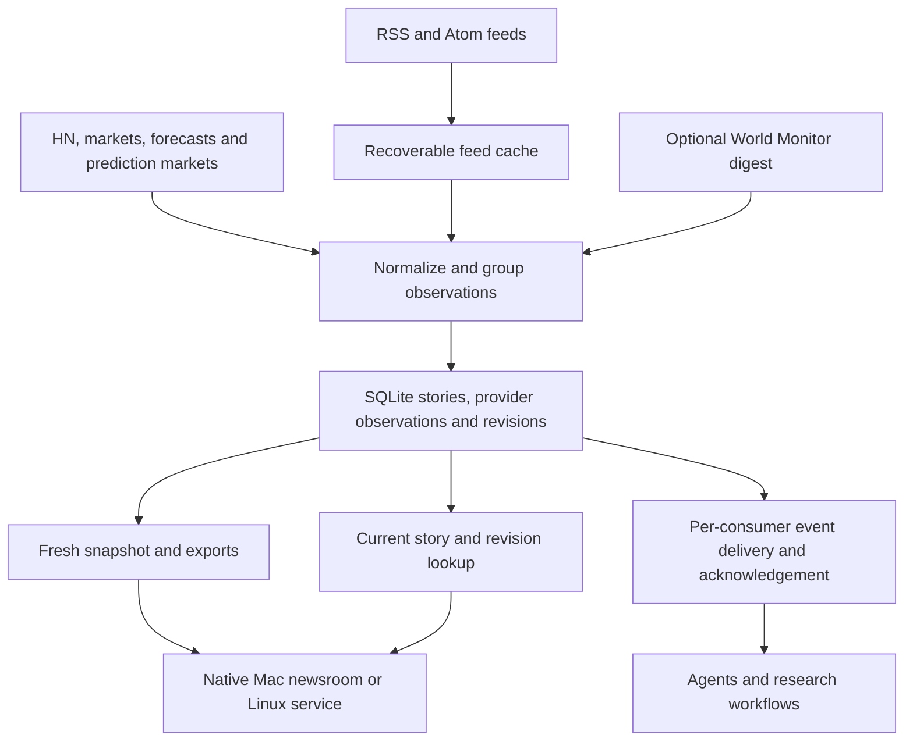

# Agent News Bot


A local-first **news desk for AI agents**. Agent News Bot scans 14 topic "desks" from public,
key-free sources, groups related stories while preserving their sources, tracks new and changed reports, generates
a length-checked X draft and hashtags for each item, and serves the fresh batch over a small
token-authenticated HTTP API bound to `127.0.0.1`. An agent, script, or newsroom pipeline can ask
"what's actually new right now?" and get a clean JSON answer instead of re-scraping the open web.

It ships as **two parallel implementations of the same design**:

- **macOS app** (`Sources/`) — a native SwiftUI desktop newsroom with a dark UI, menu-bar extra,
  restored snapshots, configurable automatic refresh, JSON exports, and optional one-click handoff to local agent runtimes.
- **Linux service** (`linux/agent_newsbot/`) — a headless Python daemon (systemd-friendly) with a
  periodic fetch loop and a `latest.json` file snapshot for file-based consumers.

Both speak the **same HTTP bridge API** and share the same freshness model, so an agent written
against one works against the other. An optional **World Monitor connector** adds digest headlines,
location context and provider assessments. It is disabled by default; the existing key-free feeds
work independently. See [World Monitor integration and durable delivery](docs/worldmonitor.md), [post validation and coverage](docs/POST_LENGTH_AND_COVERAGE.md), and [snapshots and refresh](docs/SNAPSHOT_AND_REFRESH.md).

---

## Table of contents

- [Who it's for](#who-its-for)
- [Key features](#key-features)
- [The 14 desks & their sources](#the-14-desks--their-sources)
- [Architecture](#architecture)
- [The freshness model](#the-freshness-model)
- [The bridge API](#the-bridge-api)
- [Privacy & data model](#privacy--data-model)
- [Build & run — macOS](#build--run--macos)
- [Build & run — Linux](#build--run--linux)
- [Configuration](#configuration)
- [Optional agent integrations](#optional-agent-integrations-macos)
- [Screenshots](#screenshots)
- [Project layout](#project-layout)
- [Contributing](#contributing)
- [License](#license)

---

## Who it's for

- **Agent / automation authors** who need a deduplicated, time-bounded feed of current headlines
  and want to call one localhost endpoint instead of maintaining scrapers.
- **Newsroom / social pipelines** that must avoid re-posting the same story: the durable event log provides independent consumer cursors and explicit acknowledgements. Consumers must process deliveries idempotently.
- **Anyone who wants a private, keyless news aggregator** on their own machine — no accounts, no API
  keys, no third-party analytics.

## Key features

- **14 desks** spanning general news, finance, tech/AI, prediction markets, and weather.
- **Key-free default sources.** Public RSS/Atom and JSON APIs work without keys. The optional World Monitor connector can use a self-hosted endpoint or an appropriately licensed hosted API.
- **New stories and updates.** A SQLite story journal groups canonical URLs and similar headlines, preserves source links, and emits revisions for changed titles, summaries or added sources. The lookback window defaults to 12h. Snapshot reads are repeatable; use the event API for consumer-specific delivery.
- **Validated social drafts.** Each article carries a `tweet` measured by the shared official twitter-text parser (weighted Unicode, emoji, NFC and URL counting), plus suggested hashtags. Drafts require editorial review. See [post validation and source coverage](docs/POST_LENGTH_AND_COVERAGE.md).
- **Persistent research library.** Search retained stories beyond the fresh batch, save watchlists, bookmark stories and mute sources without losing agent events. Review source links and revision history, edit YouTube/X/TikTok templates, and approve a specific revision. Corrections require review again. [Library, API and CLI guide](docs/RESEARCH_LIBRARY.md).
- **Portable research packages.** Export saved drafts, provenance and source URLs into a separate private folder for each export. Paste URLs into VideoBot's Inspect URLs workflow; review media availability and rights before queueing. No automatic publishing or downloads.
- **Observable source coverage.** The Mac Coverage window and HTTP/JSON output distinguish successful, partial, stale, unavailable and unknown checks. New, updated, carried and displayed counts are separate.
- **Token-authenticated localhost bridge.** `GET /v1/fresh`, `/v1/desks`, `/v1/status`, and
  `POST /v1/fetch`, bound to `127.0.0.1` only, behind a bearer token that is generated on first run.
- **Two runtimes, one contract.** Native macOS app *and* headless Linux daemon expose the same API.
- **Live-desk carry-over (Linux).** If a desk produces nothing new this cycle, still-fresh items from
  the previous batch are retained so the desk never looks empty while it's simply current.

## The 14 desks & their sources

| Desk | Source(s) | API key? |
|------|-----------|----------|
| `breaking` | NPR, BBC, NY Times, AP (RSS) | none |
| `politics` | NPR, BBC, NY Times, Politico, The Hill (RSS) | none |
| `world` | BBC, NPR, NY Times, Al Jazeera, Deutsche Welle, AP (RSS) | none |
| `business` | NPR, BBC, CNBC, Yahoo Finance, MarketWatch (RSS) | none |
| `tech` | Ars Technica, The Verge, TechCrunch, Wired, BBC, The Register (RSS) | none |
| `ai` | TechCrunch AI, Verge AI, MIT Tech Review, Simon Willison, Hugging Face, Google AI, NVIDIA, VentureBeat, arXiv cs.AI/cs.LG, Wired AI (RSS) | none |
| `science` | NPR, BBC, NY Times, ScienceDaily, NASA (RSS) | none |
| `health` | NPR, BBC, NY Times, Medical News Today (RSS) | none |
| `entertainment` | BBC, Variety, Deadline, Hollywood Reporter (RSS) | none |
| `sports` | NPR, BBC Sport, ESPN, Yahoo Sports (RSS) | none |
| `markets` | Yahoo Finance chart API (configurable symbol list) | none |
| `hackerNews` | Hacker News Firebase API (new + top stories) | none |
| `polymarket` | Polymarket Gamma API (events + markets, by 24h volume) | none |
| `weather` | Open-Meteo geocoding + forecast API | none |

> The exact feed URLs live in `linux/agent_newsbot/config.py` (Python) and `Sources/Feeds.swift`
> (Swift). Add or remove feeds by editing those tables.

## Architecture



**macOS implementation (`Sources/`, Swift/SwiftUI):**

- `App.swift` / `ContentView.swift` / `SettingsView.swift` — the desktop UI, menu-bar extra, and
  keyboard commands (⌘R fetch, ⇧⌘H send to Hermes).
- `Engine.swift` — orchestrates concurrent per-desk fetches, merges/sorts, marks items seen, exports
  JSON, and creates/loads the bridge token.
- `AgentBridge.swift` — a tiny hand-rolled `sockaddr_in` HTTP server bound to `127.0.0.1`, serving the
  bridge API.
- `RSSClient`/`HNClient`/`PolymarketClient`/`MarketsClient`/`WeatherClient` — one fetcher per source
  family; `Freshness.swift` is the SQLite ledger; `Hashtagger.swift` builds tags + tweets.
- `SettingsStore.swift` — `UserDefaults` for config, **Keychain** for optional integration tokens.
- `HermesClient.swift` / `OpenClawClient.swift` — optional handoff to local agent runtimes.

**Linux implementation (`linux/agent_newsbot/`, Python 3, stdlib + `feedparser` + `requests`):**

- `server.py` — `ThreadingHTTPServer` on `127.0.0.1`, bearer-token auth, background fetch loop,
  atomic `latest.json` writes.
- `engine.py` — the concurrent fetchers (`ThreadPoolExecutor`), one per desk family.
- `store.py` — the SQLite freshness ledger (`seen` + `quotes` tables), URL canonicalization, date
  parsing, HTML stripping.
- `config.py` — feed tables, desk titles/tags, and all env-var-driven configuration.
- `hashtags.py` — the tag + 280-char tweet composer.
- `__main__.py` — CLI: `serve` | `fetch` | `status`.

## The freshness model

An article identity is derived from its canonical URL. Tracking parameters are removed.
Recent similar headlines are grouped heuristically into a story, with every source retained.
Grouping is not independent verification: syndicated copies can describe the same event.

`stories.sqlite` stores current stories, separate provider observations and immutable revisions.
Each ingestion transaction emits one complete revision per changed story. Editorial changes produce
updates; stable context/provenance produces enrichment events. Score/count/time-only changes update
current state without event spam. New substantive observations can replace older headlines while
alternate reports remain visible. Multiple desk memberships and disagreement flags aid review.
See [the story model and migration contract](docs/STORY_MODEL.md) for selection rules and limitations.
Stories and events currently remain until explicitly managed; automated retention is a release task.

`GET /v1/fresh` returns the **current snapshot** and can return the same items on repeated calls.
Linux may retain still-fresh items when a desk has no changes. For durable delivery use
`GET /v1/events?consumer=<name>` and acknowledge only after successful processing with
`POST /v1/events/ack?consumer=<name>&through=<next_cursor>`. Each consumer has its own cursor.
Unacknowledged events are redelivered, including after a restart. This is **at-least-once**, not
exactly-once delivery: deduplicate external side effects by event sequence.

Existing `seen.sqlite` data is preserved. On the first run after upgrading, articles fetched into
the new journal are emitted as new even if the legacy seen ledger already contains their URLs.
Markets and weather retain their existing change filters. RSS retains conditional HTTP caching.

## The bridge API

Base URL: `http://127.0.0.1:18765` (port configurable). All endpoints except `/health` require the
bearer token in either an `Authorization: Bearer <token>` header **or** an `X-Agent-Token: <token>`
header (verified with constant-time comparison). The server binds to loopback only and returns `401`
without a valid token or `405` on disallowed HTTP methods.

| Method & path | Auth | Description |
|---------------|------|-------------|
| `GET /health` | no | Liveness probe; returns app name + bridge URL. |
| `GET /v1/fresh?desk=<desk>&limit=<n>` | yes | The current fresh batch. Optional `desk` filter and `limit` (default 100, max 500; `400` on invalid value). |
| `GET /v1/articles/<id>` | yes | Fetch a single article from the current batch by its 24-hex id (`404` if absent). |
| `GET /v1/stories/<id>` | yes | Current durable story, even when absent from the fresh batch. Accepts recorded identity aliases. |
| `GET /v1/stories/<id>/revisions?limit=50` | yes | Recorded revisions with before/after differences (1–100). |
| `GET /v1/events?consumer=<name>&limit=<n>` | yes | Durable ordered revisions after that consumer's acknowledged cursor (limit 1–500). |
| `POST /v1/events/ack?consumer=<name>&through=<seq>` | yes | Acknowledge a delivered prefix; cannot advance past events offered to that consumer. |
| `GET /v1/desks` | yes | Per-desk new/updated/carried/displayed counts, source errors and coverage. |
| `GET /v1/status` | yes | Snapshot summary: fresh count, `fetched_at`, source coverage and fetch-job status. |
| `POST /v1/fetch` | yes | Start a refresh: `202` with a job ID and `/v1/status` polling URL; `409` if already running. Poll until `fetch_job.state` is `completed` or `failed`. |

A successful refresh request is **accepted**, not completed. Read `fetch_job.id` from the
202 response, then poll `/v1/status`. Its `fetch_job` includes `state` (`running`,
`completed`, `failed`), start/end times and a final `total_articles` only on success.
Check that the ID matches your request; another client may start a later job.
A 409 response means work is already running; it does not return a completed snapshot.
`desks[].fresh` counts changes this cycle; Linux also reports `new`, `updated`,
`carried` and `displayed` so retained articles are not mislabeled as new.

**Example (Linux service, token read from its export file):**

```bash
TOKEN=$(cat "$AGENT_NEWSBOT_HOME/export/bridge.token")
curl -sS -H "Authorization: Bearer $TOKEN" 'http://127.0.0.1:18765/v1/fresh?desk=ai&limit=20'
curl -sS -H "Authorization: Bearer $TOKEN"  'http://127.0.0.1:18765/v1/desks'
curl -sS -X POST -H "Authorization: Bearer $TOKEN" 'http://127.0.0.1:18765/v1/fetch'
```

On macOS the token is shown in **Settings → Bridge** and is written to
`~/Library/Application Support/AgentNewsBot/bridge.token`.

**Article JSON shape:**

```json
{
  "id": "3f2a…", "desk": "ai", "category": "AI",
  "title": "…", "url": "https://…", "source": "TechCrunch AI",
  "published": "2026-08-15T13:04:00+00:00", "summary": "…",
  "tweet": "… https://… #AI #LLM", "tweet_chars": 174,
  "hashtags": ["#AI", "#LLM"]
}
```

## Privacy & data model

- **Local-first.** The service runs on your machine and binds to `127.0.0.1`. Nothing is exposed to
  the network by default.
- **No telemetry.** The default sources need no credentials. Optional World Monitor may require a provider key; macOS stores it in Keychain, Linux reads it from the service environment.
- **Persisted state:** the existing freshness ledger, feed cache and snapshots, plus `stories.sqlite`
  containing source headlines/snippets/links, provider metadata, immutable revisions and consumer cursors.
  This is a research record, not an archive of full publisher articles.
- **The bearer token is generated on first run** (macOS: a UUID-derived 32-hex string written 0600;
  Linux: `secrets.token_hex(16)` written 0640) and never leaves the machine. It is **not** in source
  control. Optional integration tokens on macOS are stored in the **Keychain**, not in plists.
- **Source rights remain separate.** Agent News Bot stores source metadata and excerpts and serves them to local consumers; it does not grant permission to republish upstream content. Each
  upstream source's own terms govern use of its feed.

## Build & run — macOS

Requirements: macOS 14+, the Swift toolchain (Xcode or Command Line Tools). No Xcode project and no
third-party Swift packages — it compiles straight from source with `swiftc`.

```bash
./build.sh                        # builds for host architecture (arm64 on Apple Silicon)
./build.sh --arch universal       # optional universal (arm64 + x86_64) build
open "build/Agent News Bot.app"
```

`build.sh` renders the icon, compiles all `Sources/*.swift` into an app bundle (supporting Apple
Silicon `arm64`, Intel `x86_64`, or `universal`), writes `Info.plist` (scoped to
`NSAllowsLocalNetworking` only), ad-hoc code-signs and verifies the bundle in
`build/Agent News Bot.app`. It does not install or remove any existing application or saved data.
Open that bundle, choose **Fetch Fresh** (⌘R), and the bridge starts automatically on
`127.0.0.1:18765` (and writes an atomic `latest.json` alongside pruned timestamped exports).

To install a new copy, run `./build.sh --install`. The installer refuses to overwrite
an existing `/Applications/Agent News Bot.app`; review the built copy and replace an
old installation manually if desired. It never removes NewsBot or its saved data.

## Build & run — Linux

Requirements: Python 3.10+, `pip install feedparser requests`.

Run it directly from the package directory:

```bash
cd linux
pip install feedparser requests
python3 -m agent_newsbot serve      # start the API + periodic fetch loop
python3 -m agent_newsbot fetch      # run one fetch, print JSON
python3 -m agent_newsbot status     # show last snapshot counts
```

For a long-running deployment, install it as a systemd service:

```bash
cd linux
sudo ./install.sh          # creates the 'agentnewsbot' user, installs to /opt/agent-news-bot,
                           # state under /var/lib/agent-news-bot, and starts agent-news-bot.service
```

`install.sh` is fully env-var driven — override `PREFIX`, `STATE_DIR`, and `SVC_USER` to install
elsewhere or under a different service account. It builds the unit from
[`agent-news-bot.service.example`](linux/agent-news-bot.service.example) (a plain, path-agnostic
example you can also install by hand). Nothing about any host is baked into these files.

## Configuration

The Linux service is configured entirely through environment variables (all optional):

| Variable | Default | Meaning |
|----------|---------|---------|
| `AGENT_NEWSBOT_HOME` | *(set per install)* | State dir (SQLite ledger + `export/bridge.token`). |
| `AGENT_NEWSBOT_SHARED` | *(set per install)* | Dir where `latest.json` snapshot is written. |
| `AGENT_NEWSBOT_PORT` | `18765` | Bridge port (always bound to `127.0.0.1`). |
| `AGENT_NEWSBOT_LOOKBACK_HOURS` | `12` | Freshness window. |
| `AGENT_NEWSBOT_MAX_PER_DESK` | `20` | Max items kept per desk. |
| `AGENT_NEWSBOT_WEATHER_CITY` | `New York` | City for the weather desk. |
| `AGENT_NEWSBOT_SYMBOLS` | S&P/Dow/Nasdaq/mega-caps/BTC/ETH | Comma-separated market symbols. |
| `AGENT_NEWSBOT_FETCH_INTERVAL` | `900` | Seconds between background fetches. |
| `AGENT_NEWSBOT_RETENTION_DAYS` | `30` | Days to retain rows in SQLite `seen` ledger before pruning. |

On macOS the equivalent settings live in **Settings** (lookback, max per desk, weather city, market
symbols, bridge port, enabled desks) and persist in `UserDefaults`.

## Optional agent integrations (macOS)

The macOS app can hand a selected batch to a **local** agent runtime if one is installed:

- **Hermes** — via a `hermes` CLI on `PATH`, or an OpenAI-compatible chat endpoint (default probe
  `http://127.0.0.1:8642`; optional bearer token stored in Keychain).
- **OpenClaw** — via an `openclaw` CLI, or a local gateway (default `ws://127.0.0.1:18789`).

Both are **optional** and default to localhost. If neither is present, agents can still simply
`GET /v1/fresh` from the bridge — the integrations are a convenience, not a requirement. On launch
the app also writes a small skill descriptor to `~/.hermes/skills/` and `~/.agents/skills/`
referencing the `0600` token file path (never embedding the raw token in plaintext) so a co-located
agent can discover the local desk safely.

## Screenshots

No screenshots are committed to this repository. The only bundled image is the app icon source at
`Resources/icon-1024.png` (used by `build.sh` to generate the `.icns`). If you add screenshots,
place them under a top-level `docs/` or `screenshots/` directory and reference them here.

## Project layout

```
.
├── .github/workflows/ci.yml     # CI: Linux pytest + feed parity, macOS Apple Silicon build
├── build.sh                     # macOS build (--arch arm64|x86_64|universal; optional --install)
├── Resources/                   # app icon source + icon-drawing script
├── Sources/                     # macOS SwiftUI app (one file per concern)
├── skills/agent-news-bot/       # generic skill descriptor (localhost API)
├── tests/                       # pytest suite (store, API, fuzzy dedup, Swift/Python parity)
└── linux/
    ├── pyproject.toml               # Python package metadata & dependencies
    ├── requirements.txt             # runtime dependencies
    ├── agent_newsbot/               # Python package: server, engine, store, config…
    ├── agent-newsbot                # CLI wrapper
    ├── install.sh                   # generic systemd + isolated venv installer
    ├── agent-news-bot.service.example  # path-agnostic example unit
    └── SKILL.md                     # localhost skill descriptor
```

## Contributing

- Adding a source is usually just a new row in the feed tables (`Sources/Feeds.swift` /
  `linux/agent_newsbot/config.py`) — the RSS path needs no code.
- New source *families* (a non-RSS API) get a small dedicated fetcher mirroring the existing
  `*Client`/`fetch_*` pattern and must respect the freshness ledger.
- Keep the Swift and Python implementations **behaviorally in sync** — they share one API contract.
- Never commit tokens, real hostnames, private paths, or personal data; configuration flows through
  env vars (Linux) and Settings/Keychain (macOS).

Project page: [shadowfetchlinux.org/open-source/projects/agent-news-bot](https://www.shadowfetchlinux.org/open-source/projects/agent-news-bot)

Like this project? You can [buy me a coffee](https://www.buymeacoffee.com/shadowfetcu).

## License

**MIT** (see [LICENSE](LICENSE)). The project uses only system frameworks on macOS and
permissively-licensed Python dependencies (`feedparser`, `requests`), so there is no copyleft
obligation. The World Monitor connector is independently implemented against its REST contract and embeds no World Monitor platform code. Source-code licensing does not grant rights to upstream news or hosted-service outputs; each provider's terms govern that use.

### Credential and skill safety

On macOS, use **Settings → Credentials → Save credential changes** explicitly. Closing
Settings saves ordinary preferences but does not alter secrets. Failed Keychain reads
prevent replacement of the affected credential; failed updates retain the old value.
Agent skill installation is explicit and never overwrites an existing `SKILL.md`.

The Linux installer defaults the CLI to the service's state directory. Run service
operations as the service account, for example `sudo -u agentnewsbot agent-newsbot status`,
using the configured service username if it differs. For a separate user instance, set
`AGENT_NEWSBOT_HOME` explicitly. Do not make the service token world-readable.
